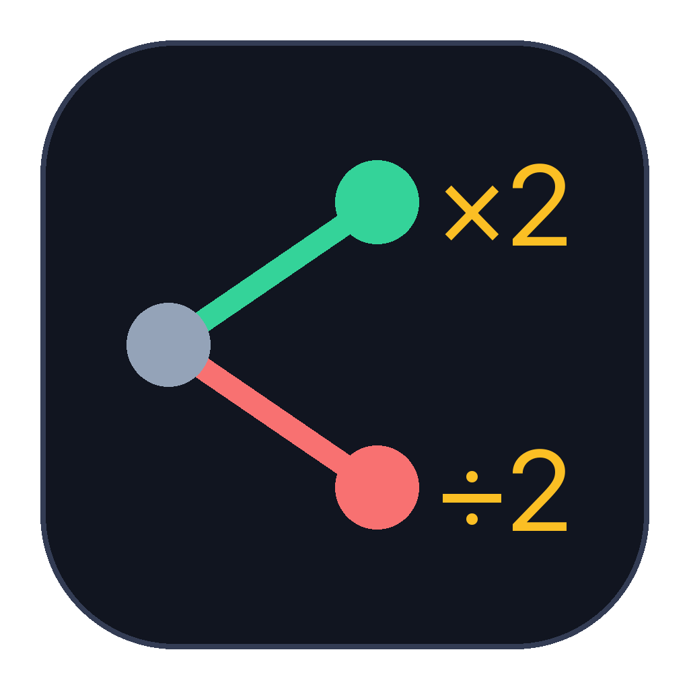
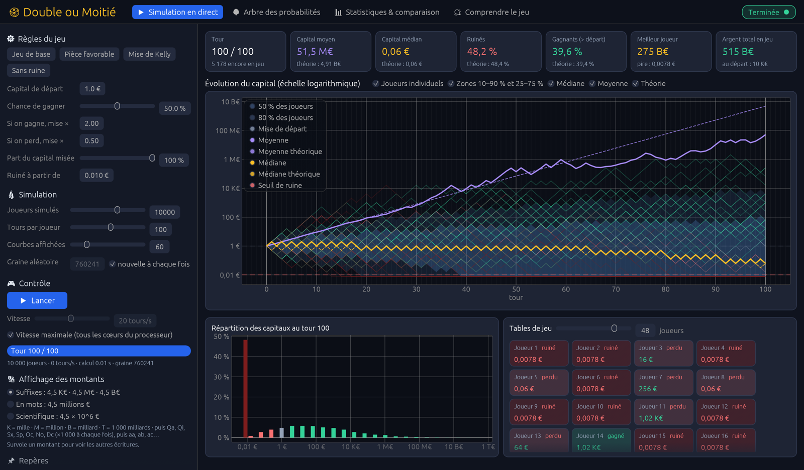
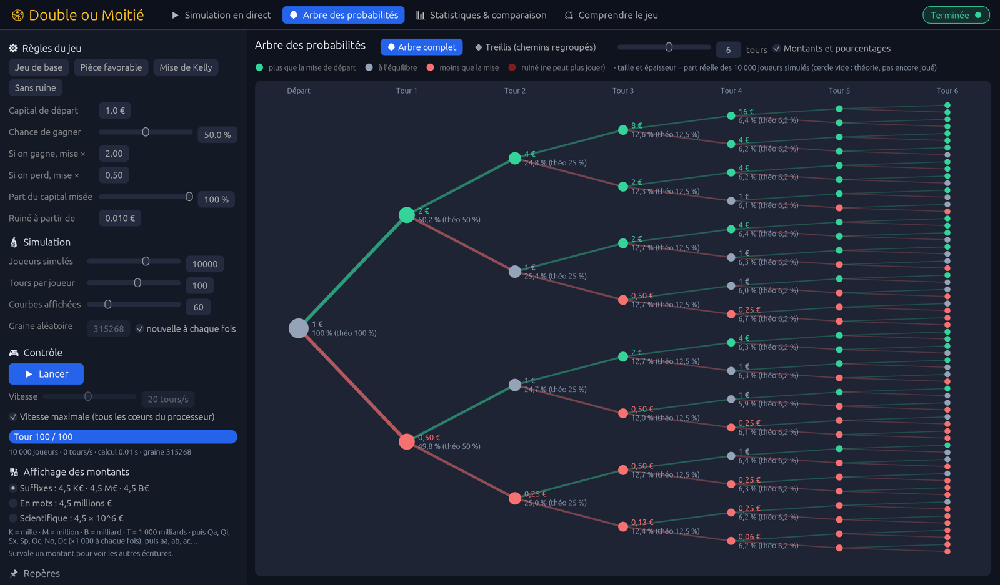
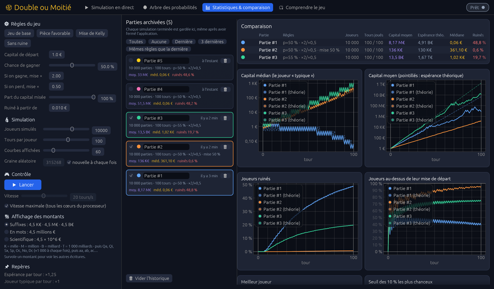
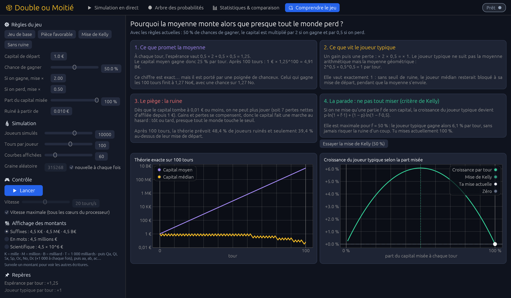

<div align="center">



# Double ou Moitié

**Un jeu qui rapporte +25 % par tour en moyenne… et qui ruine presque tout le monde.**
Simulateur graphique natif en Rust : des millions de parties en direct, arbres de probabilités et statistiques comparées.


</div>



## 🎲 Le jeu

Tu mises **1 €**. Une chance sur deux de repartir avec **2 €**, une chance sur deux avec **0,50 €**.
Tu remises tout à chaque tour : à 2 € tu peux finir à 4 € ou 1 €, et ainsi de suite.
Quand il ne te reste qu'**un centime**, tu ne peux plus jouer.

Sur le papier, le jeu est gagnant : l'espérance vaut 0,5 × 2 + 0,5 × 0,5 = **1,25** par tour.
En pratique, après 100 tours, près de **la moitié des joueurs sont ruinés** et le joueur médian a 6 centimes.
Ce simulateur montre pourquoi.

## ✨ Fonctionnalités

| | |
|---|---|
| **Simulation en direct** | Jusqu'à 2 millions de joueurs et 5 000 tours. Trajectoires individuelles, zones 10–90 % et 25–75 %, médiane, moyenne, courbes théoriques, répartition des capitaux et « tables de jeu » animées. |
| **Arbre des probabilités** | Arbre complet (10 tours) ou treillis où les chemins équivalents se rejoignent (40 tours). Chaque nœud montre la part réelle des joueurs à côté de la probabilité théorique. |
| **Statistiques & comparaison** | Chaque partie est archivée (et gardée entre deux lancements). On en sélectionne une ou plusieurs pour comparer tableau et graphiques superposés. |
| **Comprendre le jeu** | Espérance contre joueur typique, piège de la ruine, et mise optimale de Kelly (ne miser que 50 % fait gagner +6,1 % par tour au joueur typique). |
| **Règles modifiables** | Probabilité de gain, multiplicateurs, part du capital misée, seuil de ruine, capital de départ. |
| **Montants lisibles** | Notation au choix : `4,5 Qa€`, `4,5 billiards €` ou `4,5 × 10^15 €`. |

<table>
  <tr>
    <td></td>
    <td></td>
  </tr>
  <tr>
    <td align="center"><em>Arbre des probabilités</em></td>
    <td align="center"><em>Comparaison : jeu de base, mise de Kelly, pièce à 55 %</em></td>
  </tr>
</table>



## ⚡ Sous le capot

- **Rust + [egui](https://github.com/emilk/egui) / [egui_plot](https://github.com/emilk/egui_plot)** pour une interface native fluide à 60 images/s.
- **[rayon](https://github.com/rayon-rs/rayon)** : chaque tour est simulé en parallèle sur tous les cœurs, environ **300 millions de tours-joueur par seconde** (1 million de joueurs × 200 tours en 0,6 s sur un Mac M-series).
- **Calcul en logarithme** : un joueur qui gagne 1 000 fois d'affilée dépasse 10^300 €, au-delà de ce qu'un `f64` sait stocker.
- **Théorie exacte en parallèle** : la distribution complète (avec la ruine) est recalculée tour par tour sur le treillis, pour comparer simulation et théorie.
- **Quantiles en un seul passage** : histogramme à 4 096 classes, exact sur le treillis du jeu.
- **Reproductible** : une graine donne toujours le même résultat, quel que soit le nombre de cœurs.

## 🚀 Lancer

```bash
git clone https://github.com/Duapar13/double-ou-moitie.git
cd double-ou-moitie
cargo run --release
```

Sur macOS, pour l'installer dans `/Applications` avec son icône :

```bash
./scripts/install.sh
```

Options de lancement : `--auto` démarre une simulation tout de suite, `--max` à vitesse maximale, `--onglet=arbre|stats|theorie` ouvre un onglet.

## 🧪 Tests

```bash
cargo test --release
```

Les tests vérifient notamment que la simulation retrouve la théorie (part de ruinés, de gagnants, capital moyen) et que les formats de montants sont corrects.

## 📄 Licence

MIT — voir [LICENSE](LICENSE).
